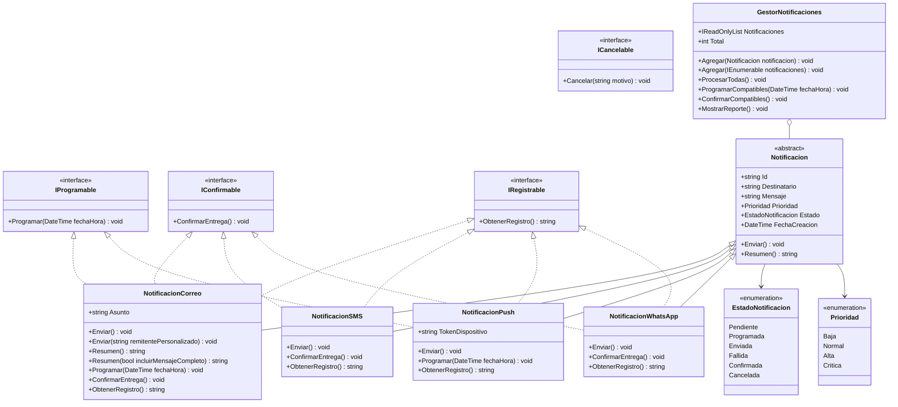

# Sistema Multicanal de Notificaciones — Reto de Diseño Polimórfico
**Asignatura:** Lenguaje de Programación II (INF-512) | **Lenguaje:** C# (.NET 8.0+)  
**Tema:** Jerarquías de Clases, Polimorfismo Dinámico, Interfaces, Sobrecarga y Colecciones de Objetos  

---

## 1. Descripción del Proyecto

El **Sistema Multicanal de Notificaciones** es una solución orientada a objetos en C# diseñada para ilustrar y aplicar los principios fundamentales del diseño polimórfico, la segregación de interfaces y el bajo acoplamiento.

El sistema orquesta el envío de notificaciones a través de diversos canales de comunicación físicos y lógicos:
- **Correo Electrónico (`NotificacionCorreo`):** Mensajería estructurada con asunto y cuerpo. Soporta programación diferida, confirmación de acuse de recibo y bitácora de auditoría.
- **Mensaje de Texto Móvil (`NotificacionSMS`):** Canal de longitud restringida (máximo 160 caracteres). Soporta confirmación de entrega y auditoría; por regla de negocio es de despacho inmediato (no programable).
- **Alerta Push (`NotificacionPush`):** Mensajería hacia dispositivos móviles mediante tokens. Soporta programación diferida y auditoría; no soporta confirmación de entrega bidireccional.
- **WhatsApp Business (`NotificacionWhatsApp`):** Canal de mensajería instantánea para demostrar la extensibilidad del sistema sin modificar el procesador central.

Todas las notificaciones son administradas por `GestorNotificaciones`, el cual implementa una política de despacho basada en prioridades (`Critica` → `Alta` → `Normal` → `Baja`) consumiendo únicamente el contrato de la clase base `Notificacion`.

---

## 2. Diagrama de Clases UML

### 2.1. Diagrama Mermaid



### 2.2. Diagrama Estructural (Vista de Texto / ASCII)

```text
                           ┌────────────────────────┐
                           │     <<interface>>      │
                           │      IProgramable      │
                           ├────────────────────────┤
                           │ +Programar(fecha) void │
                           └───────────▲────────────┘
                                       │
           ┌───────────────────────────┴────────────────────────────────┐
           │ (implementa)              │ (implementa)                   │
           │                           │                                │
 ┌─────────┴──────────────┐  ┌─────────┴──────────────┐                 │
 │   NotificacionCorreo   │  │    NotificacionPush    │                 │
 ├────────────────────────┤  ├────────────────────────┤                 │
 │ +Asunto: string        │  │ +TokenDispositivo      │                 │
 │ +Enviar() void         │  │ +Enviar() void         │                 │
 └─────────┬──────────────┘  └─────────┬──────────────┘                 │
           │                           │                                │
           │ (hereda de)               │ (hereda de)                    │
           └─────────────┐       ┌─────┘                                │
                         │       │                                      │
                    ┌────▼───────┴───────────┐                          │
                    │      <<abstract>>      │                          │
                    │      Notificacion      │                          │
                    ├────────────────────────┤                          │
                    │ +Id: string            │                          │
                    │ +Destinatario: string  │                          │
                    │ +Mensaje: string       │                          │
                    │ +Prioridad: Prioridad  │                          │
                    │ +Estado: EstadoNotif   │                          │
                    ├────────────────────────┤                          │
                    │ +Enviar()* void        │                          │
                    │ +Resumen() string      │                          │
                    └────▲───────────▲───────┘                          │
                         │           │                                  │
           ┌─────────────┘           └─────────────┐                    │
           │ (hereda de)               (hereda de) │                    │
 ┌─────────┴──────────────┐  ┌─────────────────────┴──┐                 │
 │    NotificacionSMS     │  │  NotificacionWhatsApp  │                 │
 ├────────────────────────┤  ├────────────────────────┤                 │
 │ +MaximoChars: 160      │  │ +Enviar() void         │                 │
 │ +Enviar() void         │  │ +ConfirmarEntrega()    │                 │
 └─────────┬──────────────┘  └─────────┬──────────────┘                 │
           │                           │                                │
           │ (implementa)              │ (implementa)                   │
           └───────────────────────────┬────────────────────────────────┘
                                       │
                           ┌───────────▼────────────┐
                           │     <<interface>>      │
                           │      IConfirmable      │
                           ├────────────────────────┤
                           │ +ConfirmarEntrega()    │
                           └────────────────────────┘

 Relación con el Gestor:
 ┌─────────────────────────┐           contiene           ┌────────────────────────┐
 │  GestorNotificaciones   │ ◆──────────────────────────> │   List<Notificacion>   │
 └─────────────────────────┘                              └────────────────────────┘
```

---

## 3. Fundamentos de Diseño y Conceptos Clave

### 3.1. Polimorfismo Dinámico (Tipo Declarado vs. Tipo Real)
En C#, el **polimorfismo dinámico** ocurre en tiempo de ejecución (runtime) cuando una referencia del tipo base invoca un método virtual o abstracto sobrescrito:
```csharp
Notificacion n = new NotificacionSMS("+1-809-555-0199", "Alerta", Prioridad.Alta);
n.Enviar();
```
- **Tipo Declarado (Compile-time):** `Notificacion`. Determina qué miembros son visibles para el compilador.
- **Tipo Real (Runtime):** `NotificacionSMS`. Es el tipo concreto instanciado en la memoria *heap*.
- **Despacho Dinámico:** Mediante la tabla de métodos virtuales (*vtable*), el CLR despacha la invocación hacia el método `override Enviar()` definido en `NotificacionSMS`.

### 3.2. ¿Por qué `Notificacion` es Abstracta?
- Representa una abstracción pura. No existe en el mundo real una "notificación genérica" que pueda enviarse por el aire sin un canal de transmisión concreto.
- Marcar la clase como `abstract` impide su instanciación errónea (`new Notificacion(...)` produciría error de compilación).
- Establece un **contrato estricto** obligando a las subclases a suministrar la lógica concreta de `Enviar()`.

### 3.3. Sobrescritura (`override`) vs. Sobrecarga (`overload`)
| Criterio | Sobrescritura (`override`) | Sobrecarga (`overload`) |
| :--- | :--- | :--- |
| **Definición** | Reemplaza la implementación de un método heredado (`abstract` o `virtual`). | Define un método adicional con el **mismo nombre**, pero con distinta lista de parámetros. |
| **Resolución** | Tiempo de ejecución (*Dynamic Binding* / *Late Binding*). | Tiempo de compilación (*Static Binding* / *Early Binding*). |
| **Firmas** | La firma (nombre y parámetros) debe ser **exactamente idéntica**. | La firma de parámetros **debe diferir** en cantidad, orden o tipos. |
| **Tipo de retorno** | Debe ser el mismo (o covariante). | **No basta con cambiar el retorno** para sobrecargar un método. |
| **Ejemplo en el código** | `NotificacionSMS.Enviar()` sobrescribe `Notificacion.Enviar()`. | `Gestor.Agregar(Notificacion)` y `Gestor.Agregar(IEnumerable<Notificacion>)`. |

> **Nota técnica:** En C#, la firma para resolver sobrecargas solo incluye el nombre del método y sus parámetros. Si dos métodos comparten el mismo nombre y los mismos parámetros, pero difieren solo en el tipo de retorno (`public int Enviar(int c)` vs `public double Enviar(int c)`), el compilador arroja error CS0111 (*duplicate signature*), ya que en llamadas donde no se use el valor de retorno sería imposible determinar a cuál invocar.

### 3.4. Interfaces como Capacidades Opcionales (ISP)
- `IProgramable`, `IConfirmable` e `IRegistrable` modelan comportamientos **transversales u opcionales**.
- Si `ConfirmarEntrega()` o `Programar()` se colocaran en la clase base `Notificacion`, canales como `NotificacionPush` (que no confirma entrega) o `NotificacionSMS` (que no se programa) tendrían que implementar métodos vacíos o lanzar `NotSupportedException`.
- Esto respeta el **Principio de Segregación de Interfaces (ISP)**: los clientes no deben ser forzados a depender de interfaces o métodos que no utilizan.

### 3.5. Encapsulamiento y Control de Estado
- `Estado` posee un modificador de acceso `protected set`.
- Esto garantiza que **la propia jerarquía de clases gobierna sus transiciones de estado** (por ejemplo: de `Pendiente` a `Enviada` al invocar `Enviar()`, o a `Confirmada` en `ConfirmarEntrega()`).
- Un consumidor externo no puede modificar arbitrariamente el estado (`n.Estado = EstadoNotificacion.Confirmada;` es rechazado por el compilador).

### 3.6. Desacoplamiento del `GestorNotificaciones`
El gestor no contiene condicionales basados en tipos concretos:
```csharp
// Enfoque polimórfico (Abierto para extensión, cerrado para modificación):
foreach (Notificacion n in _notificaciones.OrderByDescending(n => n.Prioridad))
{
    n.Enviar();
}

// Enfoque acoplado (no recomendado):
// if (n is NotificacionSMS) ((NotificacionSMS)n).Enviar();
// else if (n is NotificacionCorreo) ((NotificacionCorreo)n).Enviar();
```
El enfoque acoplado liga el gestor a cada canal existente, obligando a modificar el gestor cada vez que surja un nuevo canal (`NotificacionWhatsApp`, `NotificacionTelegram`).

---

## 4. Estructura de Archivos del Proyecto

```text
c:\Users\cesar\Desktop\ProyectoINF\
│
├── SistemaNotificaciones.csproj   # Archivo de configuración del proyecto .NET 8
├── Enums.cs                      # Enumeraciones: EstadoNotificacion y Prioridad
├── Interfaces.cs                 # Contratos: IProgramable, IConfirmable, IRegistrable, ICancelable
├── Notificacion.cs               # Clase base abstracta con datos comunes y Enviar()
├── NotificacionCorreo.cs         # Canal Correo (Email) con asunto y sobrecargas
├── NotificacionSMS.cs            # Canal SMS con regla de 160 caracteres encapsulada
├── NotificacionPush.cs           # Canal Push a móviles (no confirmable)
├── NotificacionWhatsApp.cs       # Canal WhatsApp (demostración de extensibilidad)
├── GestorNotificaciones.cs       # Orquestador con List<Notificacion>, sobrecargas y orden por prioridad
├── Program.cs                    # Menú interactivo y demostración completa
└── README.md                     # Documentación técnica general del proyecto
```

---

## 5. Instrucciones de Compilación y Ejecución

### Requisitos
- .NET 8.0 SDK o superior instalado.

### Comandos de Ejecución

1. Abrir una terminal en el directorio del proyecto:
   ```powershell
   cd c:\Users\cesar\Desktop\ProyectoINF
   ```

2. Compilar la solución:
   ```powershell
   dotnet build
   ```

3. Ejecutar la aplicación:
   ```powershell
   dotnet run
   ```

### Opciones del Menú
Al iniciar la aplicación, se mostrará el menú principal:
1. **Ejecutar Demostración Completa del Sistema:** Ejecuta de forma continua todo el flujo funcional del sistema (creación, lote, programación, envío por prioridad, confirmación y reporte).
2. **Polimorfismo Dinámico:** Demuestra en consola el Tipo Declarado vs. Tipo Real.
3. **Sobrecarga vs. Sobrescritura:** Muestra las diferencias prácticas y de firma.
4. **Interfaces de Capacidad:** Evalúa con `is` las capacidades de cada canal.
5. **Validaciones y Encapsulamiento:** Dispara y captura excepciones de validación temprana y de los 160 caracteres en SMS.
6. **Extensibilidad:** Demuestra cómo se incorpora `NotificacionWhatsApp` sin alterar el gestor.

---

## 6. Historial de Commits Significativos Recomendados

Para el repositorio Git colaborativo, se sugieren los siguientes commits progresivos:

1. `feat(modelo): crear clase base abstracta Notificacion y enumeraciones de estado y prioridad`
2. `feat(interfaces): definir contratos IProgramable, IConfirmable, IRegistrable e ICancelable`
3. `feat(sms): implementar NotificacionSMS con encapsulamiento de limite de 160 caracteres`
4. `feat(correo): implementar NotificacionCorreo con sobrecarga de metodos y asunto especializado`
5. `feat(push): implementar NotificacionPush modelando canal unidireccional sin confirmacion`
6. `feat(gestor): implementar GestorNotificaciones con coleccion polimorfica y orden por prioridad`
7. `feat(extensibilidad): agregar NotificacionWhatsApp comprobando principio Open/Closed`
8. `feat(ui): implementar menu de consola y flujo de demostracion completo`
9. `docs: anadir README detallado y diagrama de clases UML`

